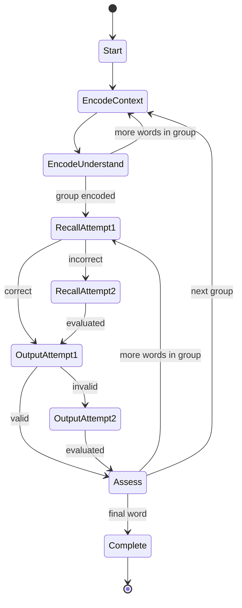

# Learn Active Recall Redesign

**Status:** Implemented  
**Owner:** Lexora  
**Supersedes:** Learning flow details in [[03-learning-session]] where this specification is more specific

## 1. Outcome

Redesign Learn around active recall instead of immediate repetition.

A session automatically groups 3–5 words. Each group first completes Context and Understand for every word. Recall, Output, and Assess happen only after that encoding phase, creating useful retrieval delay.

The redesign must make objective Recall and Output performance the primary learning signal, keep self-rating supplementary, persist both attempts, resume exactly, and complete sessions atomically and idempotently.

## 2. Non-goals

- No AI grading integration.
- No external service, credential, or runtime dependency.
- No speech recognition or pronunciation scoring.
- No replacement of SM-2.
- No gamified streak, sound, timer, countdown, or celebration layer inside Learn.
- No rich-text editor.
- No concurrent active sessions for one local learner.
- No broad redesign of Review, Vocabulary, Context, Analytics, or navigation beyond required Learn integration.

## 3. Actors and observable behavior

### Primary actor

A personal English learner using Lexora on desktop or mobile.

### Expected behavior

1. Learner selects a mode, word count, and mode-specific option.
2. Lexora creates one active session and deterministic groups.
3. Current group enters Encoding:
   - Context for word 1.
   - Understand for word 1.
   - Repeat for every word in group.
4. Same group enters Retrieval:
   - Recall, Output, Assess for word 1.
   - Repeat for every word in group.
5. Next group starts only after current group finishes.
6. Refresh or reopening Learn resumes exact group, phase, word, step, and attempt.
7. Final completion updates review schedule and knowledge scores once.
8. Repeated completion requests return same completed result without duplicate effects.

## 4. Chosen architecture

### Decision

Persist every Recall and Output attempt in dedicated `learning_attempts` table.

### Why

- Required for exact resume after first failed attempt.
- Preserves both answers and objective results.
- Supports truthful first-try and second-try summaries.
- Prevents frontend-only state loss.
- Provides future AI-evaluation input without adding AI now.
- Avoids growing `learning_session_items` with step-specific attempt columns.
- Avoids opaque JSON persistence.

### Rejected alternatives

1. Additional columns on `learning_session_items`: simpler initially, but couples unrelated Recall and Output fields and scales poorly.
2. JSON attempts on session item: smaller migration, but weak validation, difficult querying, and poor scoring/audit support.
3. Frontend-only attempts: cannot satisfy persistence or exact resume.

## 5. Session model

### 5.1 Session status

`learning_sessions.status`:

- `IN_PROGRESS`
- `COMPLETED`
- `ABANDONED`

Only one row may have `IN_PROGRESS` status.

Starting while another session is active returns `409 ACTIVE_SESSION_EXISTS`; it never silently creates another active session. Learner may resume or abandon existing session. Abandoning preserves session data but does not apply SM-2 or knowledge updates.

### 5.2 Deterministic grouping

Difficulty weights:

- `A1`, `A2`: 1
- `B1`, `B2`, unknown: 2
- `C1`, `C2`: 3

Target group size derives from average selected-word weight:

- average `< 1.5`: 5
- average `>= 1.5` and `< 2.5`: 4
- average `>= 2.5`: 3

Group count is `ceil(totalWords / targetSize)`. Words are distributed in original selection order with group sizes differing by at most one. This avoids a final one-word group where rebalancing is possible.

Sessions with fewer than three words use one smaller group.

Each session item persists:

- `position`: stable zero-based position in session
- `group_index`: stable zero-based group

Grouping never changes after session creation.

### 5.3 Server-owned cursor

Server derives and returns canonical cursor:

```typescript
type LearningCursor = {
  phase: 'ENCODE' | 'RETRIEVE' | 'COMPLETE';
  groupIndex: number;
  groupCount: number;
  groupSize: number;
  itemIndex: number;
  sessionPosition: number;
  step: 'CONTEXT' | 'UNDERSTAND' | 'RECALL' | 'OUTPUT' | 'ASSESS' | null;
  itemId: string | null;
  wordId: string | null;
  attemptNumber: 1 | 2 | null;
};
```

Cursor rules:

1. Earliest incomplete group wins.
2. If any item in group has not completed Understand, phase is `ENCODE`.
3. Encoding cursor selects first item requiring Context or Understand.
4. After all group items complete Understand, phase becomes `RETRIEVE`.
5. Retrieval cursor selects first item requiring Recall, Output, or Assess.
6. Next group remains inaccessible until current group is fully assessed.
7. All groups assessed yields `COMPLETE`.

Frontend never calculates authoritative next position.

## 6. Cognitive flow



### 6.1 Context

- Show authentic context sentence.
- Ask learner to infer meaning.
- Persist step completion immediately.
- No objective score generated.

### 6.2 Understand

Show available:

- headword
- phonetic
- part of speech
- definition
- translation
- collocations
- examples
- word family when present

Persist step completion immediately.

### 6.3 Recall

Server is authoritative. Client sends answer only; `recallCorrect` is removed from public request contract.

Attempt 1:

- Correct normalized answer: result `CORRECT`, performance score 100, Recall completes.
- Incorrect: result `INCORRECT`, attempt persists, server returns light hint, Recall remains active at attempt 2.

Hint format:

- First alphabetic character.
- Total alphabetic character count.
- No full answer.

Attempt 2:

- Correct normalized answer: result `CORRECT_AFTER_HINT`, performance score 70.
- Incorrect: result `INCORRECT`, performance score 0, server reveals answer.
- Recall completes in both cases.

Typo tolerance uses existing normalization and Levenshtein helper. An almost-correct first attempt is treated as second-tier success with performance score 70 and does not require another attempt.

### 6.4 Output

Client may mirror rules for immediate feedback. Server remains authoritative.

Local evaluator requires:

1. Non-empty sentence.
2. At least four word tokens.
3. Exact normalized target word or target phrase appears at token boundary.

No grammar-quality claim is made.

Attempt 1:

- Valid: result `VALID`, performance score 100, Output completes.
- Invalid: attempt persists with feedback codes; Output remains active at attempt 2.

Attempt 2:

- Valid: result `VALID_AFTER_FEEDBACK`, performance score 70.
- Invalid: result `INVALID`, performance score 0.
- Output completes in both cases so learner cannot become trapped.

Feedback codes are structured data, not presentation text:

- `EMPTY`
- `TOO_SHORT`
- `TARGET_MISSING`

Current evaluator source is `LOCAL`. Stored source allows later AI evaluation without changing historical meaning. No AI abstraction or dependency is added now.

### 6.5 Assess

Learner selects:

- `AGAIN`
- `HARD`
- `GOOD`
- `EASY`

Self-rating is stored but does not directly determine correctness or dimension scores.

## 7. Scoring and scheduling

### 7.1 Objective dimension scores

Each completed Learn item writes immutable review logs:

- Recall log with persisted attempt-derived performance score.
- Production log with persisted attempt-derived performance score.

Context and Understand are exposure, not objective recognition tests. Learn does not award a Recognition score from passive completion. Existing Recognition evidence from Review remains unchanged.

`review_logs.performance_score` is nullable integer 0–100.

Historical rows without `performance_score` use compatibility fallback:

- `correct = true` -> 100
- `correct = false` -> 0
- missing correctness -> rating compatibility mapping

Dimension score is average performance score for that dimension, rounded and clamped to 0–100.

### 7.2 Effective SM-2 rating

Objective score:

```text
objective = round(recallScore * 0.5 + productionScore * 0.5)
```

Self-rating modifier:

- AGAIN: -10
- HARD: -5
- GOOD: 0
- EASY: +5

```text
effectiveScore = clamp(objective + modifier, 0, 100)
```

Effective SM-2 rating:

- 0–39: `AGAIN`
- 40–59: `HARD`
- 60–84: `GOOD`
- 85–100: `EASY`

This keeps performance primary while letting confidence affect borderline cases.

Both `self_rating` and derived `effective_rating` remain inspectable in persisted data. Existing `review_logs.rating` stores effective rating; session item stores self-rating.

### 7.3 Monotonic knowledge state

Knowledge state order:

```text
NEW < LEARNING < FAMILIAR < MASTERED < MAINTENANCE
```

Scores may rise or fall as evidence changes. State never moves backward. If calculated evidence qualifies more than one level above current state, completion advances exactly one level; later qualified evidence may advance the next level. This enforces no regression and no skipped state.

## 8. Persistence design

### 8.1 `learning_sessions`

Add:

- `status TEXT NOT NULL DEFAULT 'IN_PROGRESS'`

Keep:

- `completed_at` for completion timestamp

Indexes:

- index on `status`
- index on `started_at`
- partial unique index allowing only one `IN_PROGRESS` row

### 8.2 `learning_session_items`

Add:

- `position INTEGER NOT NULL`
- `group_index INTEGER NOT NULL`

Constraints/indexes:

- unique `(session_id, position)`
- unique `(session_id, word_id)`
- index `(session_id, group_index, position)`

Keep final projection fields for compatibility and efficient summary:

- `completed_step`
- `recall_result`
- `output_sentence`
- `review_rating`

### 8.3 `learning_attempts`

```text
id                  TEXT PRIMARY KEY
session_item_id     TEXT NOT NULL FK -> learning_session_items.id ON DELETE CASCADE
request_id          TEXT NOT NULL
type                TEXT NOT NULL CHECK (RECALL | OUTPUT)
attempt_number      INTEGER NOT NULL CHECK (1 | 2)
answer              TEXT NOT NULL
result              TEXT NOT NULL
performance_score   INTEGER NOT NULL CHECK (0..100)
feedback_codes      TEXT NULL
source              TEXT NOT NULL DEFAULT LOCAL
created_at          TEXT NOT NULL
```

Constraints/indexes:

- unique `request_id`
- unique `(session_item_id, type, attempt_number)`
- index `session_item_id`
- index `(session_item_id, type)`

`feedback_codes` stores a validated JSON array of known codes. It is presentation-neutral and bounded; no arbitrary evaluator payload is accepted.

### 8.4 `review_logs`

Add:

- `performance_score INTEGER NULL`

Existing `correct` remains for compatibility.

## 9. API contract

All endpoints retain standard response envelope.

### 9.1 Options

`GET /api/learning/options`

Returns:

```typescript
type LearningOptions = {
  contexts: Array<{ id: string; title: string; wordCount: number }>;
  topics: Array<{ id: string; name: string; wordCount: number }>;
  availability: {
    newWords: number;
    weakWords: number;
    dueWords: number;
  };
};
```

Purpose: selector data without raw IDs or incomplete client-side tag discovery.

### 9.2 Start

`POST /api/learning/session`

Request keeps modes:

```typescript
type StartLearningSession = {
  mode: 'new_words' | 'context' | 'topic' | 'weak_words' | 'daily_plan';
  count: number;
  contextId?: string;
  topicId?: string;
};
```

Changes:

- Topic uses tag ID, not free text.
- No fallback from `new_words` to arbitrary learned words.
- No available words returns `422 NO_WORDS_AVAILABLE` with safe details.
- Existing active session returns `409 ACTIVE_SESSION_EXISTS`.

### 9.3 Read/resume

- `GET /api/learning/session`
- `GET /api/learning/session/:id`

Session response includes:

- stable groups/item positions
- current cursor
- persisted attempts needed for current feedback state
- completed summary when applicable

### 9.4 Submit action

Keep endpoint path for compatibility:

`POST /api/learning/session/:id/step`

Request:

```typescript
type SubmitLearningAction = {
  requestId: string;
  wordId: string;
  step: 'CONTEXT' | 'UNDERSTAND' | 'RECALL' | 'OUTPUT' | 'ASSESS';
  answer?: string;
  assessmentRating?: 'AGAIN' | 'HARD' | 'GOOD' | 'EASY';
};
```

Removed:

- `recallCorrect`
- `userSentence`

`answer` applies only to Recall or Output.

Response returns full action result plus updated cursor:

```typescript
type LearningActionResult = {
  item: LearningSessionItem;
  cursor: LearningCursor;
  feedback: {
    outcome: string;
    attemptNumber: 1 | 2 | null;
    canRetry: boolean;
    hint?: { firstLetter: string; letterCount: number };
    revealedAnswer?: string;
    codes?: string[];
  } | null;
};
```

Same `requestId` returns same result and never consumes another attempt.

### 9.5 Complete

`POST /api/learning/session/:id/complete`

- Requires cursor `COMPLETE`.
- First request applies all completion effects atomically.
- Later requests return existing completed session with 200.
- No duplicate review logs, SM-2 update, or knowledge update.

### 9.6 Abandon

`POST /api/learning/session/:id/abandon`

- Changes active session to `ABANDONED` atomically.
- Completed session cannot be abandoned.
- Repeated abandon returns existing abandoned state.
- No review or progress updates occur.

## 10. Atomicity and concurrency

Completion transaction order:

1. Load session status inside transaction.
2. Return existing completed session when status is `COMPLETED`; reject abandoned session; return not found when absent.
3. Validate all required attempts and assessments inside same transaction.
4. Conditionally update session from `IN_PROGRESS` to `COMPLETED` and set `completed_at`.
5. If no row changed, re-read status and return the already completed result or reject invalid state.
6. Insert immutable review logs.
7. Derive effective rating and update SM-2 once.
8. Update dimension scores and monotonic, one-level-at-a-time knowledge state.
9. Commit.

Any failure rolls back every effect.

Attempt submission uses unique `request_id` and unique item/type/attempt constraints. Duplicate requests return persisted result. Concurrent different requests cannot create attempt 3.

## 11. Migration and compatibility

### 11.1 Existing database migration

1. Run migration in one SQLite transaction with foreign-key enforcement enabled.
2. Add session status and item position/group columns through a table-rebuild migration where SQLite cannot apply required constraints safely in place.
3. Map rows with `completed_at` to `COMPLETED`; incomplete rows to `IN_PROGRESS`.
4. If multiple incomplete sessions exist:
   - keep newest by `started_at`, then `id`, as `IN_PROGRESS`;
   - mark older rows `ABANDONED`;
   - preserve all rows and items.
5. Assign stable item positions by `created_at`, then `id`.
6. Compute and persist group indexes using selected item difficulties.
7. Create `learning_attempts`.
8. Add nullable review performance score.
9. Create indexes and verify postconditions.
10. Rollback path restores the version-1 table shape only when no version-2 attempts or status data have been created; otherwise rollback refuses rather than discarding learning evidence.

No existing learning history is deleted.

Legacy active sessions may resume using final item fields. Missing attempt history remains unknown; system must not invent first-try success. New attempts use new table.

### 11.2 Backup format

- Backup version advances from 1 to 2.
- Version 2 includes session status, positions, groups, attempts, and review performance scores.
- Restore accepts version 1 and version 2.
- Version 1 restore applies migration defaults and empty attempt history.
- Export always emits version 2 after upgrade.
- Restore relation validation includes attempt-to-session-item foreign keys and uniqueness.

### 11.3 Frontend compatibility

Frontend types update with backend response. Existing `/learn` route remains.

Supported query parameters:

- `mode`
- `contextId`
- `topicId`

Invalid or unavailable parameters are ignored with visible form guidance; they never auto-start a session.

## 12. UI design

### 12.1 Start screen

- Session mode selector.
- Word count 1–50.
- Context selector showing title and linked-word count.
- Topic selector showing existing tag and eligible-word count.
- Availability/empty guidance.
- Existing active session card with Resume and Abandon actions.

### 12.2 Active session hierarchy

Top area:

- overall word progress
- group `X/Y`
- phase `Encoding` or `Retrieval`
- current word position within group
- Pause/Exit action that keeps session active

Main area remains centered, distraction-light, and limited to one primary action.

Desktop uses `max-w-3xl`. Mobile uses full-width cards and sticky bottom primary action when safe with virtual keyboard.

### 12.3 Focus and keyboard

- Step or phase change focuses `h2` with `tabIndex={-1}`.
- Recall retry returns focus to answer input.
- Output opens with focus on textarea.
- Enter submits Recall.
- Ctrl/Cmd+Enter submits Output.
- Keys 1–4 select Assess only when no editable element has focus.
- One keyboard handler owns rating shortcuts.
- Escape closes confirmation dialogs.
- All touch targets are at least 44×44 px.

### 12.4 Announcements

Polite live region announces:

- group and phase transition
- active step
- first failed attempt and retry availability
- final answer reveal
- session completion

Inline validation is associated through `aria-describedby`. Network errors use `role="alert"` and keep current input mounted.

### 12.5 Async states

Every query-driven Learn view handles:

- loading
- empty
- error with Retry
- default
- mutation pending with controls disabled

Typed answers survive request failure and retry.

## 13. Component boundaries

Expected frontend boundaries:

- `LearningSessionPage`: query/mutation orchestration only.
- `SessionStartForm`: mode and selector inputs.
- `SessionProgress`: overall/group/phase progress.
- `EncodingStepView`: Context and Understand.
- `RecallAttemptView`: Recall attempts and feedback.
- `OutputAttemptView`: Output attempts and feedback.
- `AssessmentView`: supplementary rating.
- `SessionSummary`: objective outcome summary.

Reuse existing Select, Button, Card, localization, API client, and React Query patterns. No new UI dependency.

Expected backend boundaries:

- Route: parse and envelope only.
- Service: cursor and transition orchestration.
- Repository: set-based reads and transactional writes.
- Domain: pure grouping, output evaluation, scoring, effective-rating, and monotonic-state functions.

Session retrieval must batch related words, examples, collocations, contexts, and attempts. It must not execute one query per item per relation.

## 14. Failure and recovery behavior

- Start with active session: 409; UI offers Resume/Abandon.
- No words available: 422; UI preserves form and suggests another mode.
- Duplicate action request: return persisted action result.
- Invalid cursor action: 409 `INVALID_SESSION_TRANSITION`.
- Third attempt: 409 `ATTEMPT_LIMIT_REACHED`.
- Request failure: current answer remains editable and same `requestId` is retried.
- Completion failure: transaction rollback; session remains resumable.
- Repeated completion: 200 with same completed session.
- Corrupt/missing relation during restore: reject before deleting current data.
- Abandoned session: readable in history, not resumable, no completion effects.

## 15. Security and data boundaries

- Server validates all session IDs, word membership, current cursor, attempt limit, answer length, and rating values.
- Client cannot send correctness or performance score.
- Feedback codes come from allowlist.
- Answer length is bounded to prevent oversized local payloads.
- No external transmission of learner answers.
- No credential or AI-provider configuration.

## 16. Acceptance criteria

### Session structure

- **AC-1:** Starting 6 medium-difficulty words creates two stable groups of three, persisted with unique positions.
- **AC-2:** All Context and Understand actions in current group complete before server cursor permits Recall.
- **AC-3:** Next group remains unavailable until current group is fully assessed.
- **AC-4:** Reload restores exact group, phase, word, step, and pending attempt from server data.

### Attempts and feedback

- **AC-5:** Incorrect Recall attempt 1 persists, returns light hint, and keeps Recall active at attempt 2.
- **AC-6:** Recall attempt 2 persists, returns correct/incorrect result, reveals answer on failure, and advances to Output.
- **AC-7:** Invalid Output attempt 1 persists structured feedback and keeps Output active at attempt 2.
- **AC-8:** Output attempt 2 always completes Output while preserving valid/invalid objective result.
- **AC-9:** Same action `requestId` never creates duplicate attempt or advances twice.
- **AC-10:** Client cannot submit Recall correctness or performance score.

### Scoring and state

- **AC-11:** First-try, second-try, and failed Recall/Output produce specified 100/70/0 performance scores.
- **AC-12:** Effective SM-2 rating uses 50/50 objective performance plus bounded self-rating modifier.
- **AC-13:** Knowledge state never regresses from existing state.
- **AC-14:** Completion summary distinguishes first-try, second-try, failed Recall, and valid/invalid Output without inventing legacy attempt detail.

### Integrity

- **AC-15:** Database permits at most one `IN_PROGRESS` session.
- **AC-16:** Two concurrent/repeated completion requests produce one set of review logs and one SM-2 update, both returning completed state.
- **AC-17:** Injected completion failure leaves session status, logs, review state, and learning progress unchanged.
- **AC-18:** Abandoning preserves session records and applies no learning updates.

### Compatibility

- **AC-19:** Existing version-1 backup restores successfully into new schema.
- **AC-20:** Version-2 backup/restore preserves attempts, grouping, status, and performance scores exactly.
- **AC-21:** Existing incomplete sessions migrate without deletion; only newest remains active when legacy data contains multiple incomplete sessions.

### UX and accessibility

- **AC-22:** Context and Topic modes use selectors with human-readable labels, never raw ID entry.
- **AC-23:** Learn handles loading, empty, error/retry, default, and mutation-pending states.
- **AC-24:** Desktop 1366×768 and mobile 375×667 have no unintended horizontal scroll.
- **AC-25:** Entire flow works by keyboard; focus moves predictably; rating shortcut fires once.
- **AC-26:** Browser console has zero uncaught errors and zero React warnings during start, resume, attempts, completion, and abandon flows.

## 17. Risks

- **RISK-1 — Migration drift:** Drizzle schema and manual SQLite DDL may diverge. Both require same postcondition tests.
- **RISK-2 — Backup incompatibility:** Strict backup schemas reject added fields unless versioned schemas and relation checks change together.
- **RISK-3 — Duplicate side effects:** Completion or attempt retry may duplicate progress without conditional updates and uniqueness constraints.
- **RISK-4 — Legacy ambiguity:** Old sessions lack attempt history. UI must label unknown detail rather than infer first-attempt success.
- **RISK-5 — Scoring behavior change:** Analytics values shift because objective 100/70/0 scores replace binary self-rating-derived signals.
- **RISK-6 — N+1 regression:** Expanded attempt data can worsen retrieval unless session loading is batched.
- **RISK-7 — Mobile keyboard obstruction:** Sticky action area may overlap Recall/Output fields without viewport verification.
- **RISK-8 — Hint leakage:** Hint generator must expose only first letter and count before second attempt.

## 18. Verification strategy

### Domain tests

- Group sizing and rebalancing.
- Recall normalization, typo handling, hint generation.
- Output rules and feedback codes.
- Performance/effective-rating mapping boundaries.
- Monotonic knowledge state.

### Backend integration tests

- All modes and no-word behavior.
- Single active-session constraint.
- Encoding/retrieval cursor enforcement.
- Two-attempt limits and request idempotency.
- Atomic completion success/failure/retry.
- Real SQLite migration from legacy fixture.
- Backup v1 import and v2 round trip.
- Batched session retrieval behavior.

### Frontend tests

- Selectors and URL prefill.
- Group and phase progression.
- Recall and Output retry feedback.
- Resume exact cursor.
- Input preservation after failed mutation.
- Single rating keyboard submission.
- Objective completion summary.

### Browser verification

- Desktop 1366×768 and 1440×900.
- Mobile 375×667 and 390×844.
- Keyboard-only traversal.
- Focus after transition and retry.
- Loading, empty, error, pending, default states.
- No horizontal overflow.
- Zero console errors/warnings.

## 19. Material deviations from earlier module specification

- Learn no longer runs all five steps immediately for one word before exposing other words.
- Recall correctness is server-derived only.
- Self-rating no longer directly controls SM-2.
- `/step` remains path-compatible but request/response contract changes.
- Dedicated attempts become source of truth for retry performance.
- Session status now includes abandonment and enforces one active session.

## 20. Implementation notes and deviations

- Implementation completed against AC-1–AC-26 with final Strict reviewer and verifier PASS.
- Output primary action uses a mobile sticky container with safe-area padding; desktop returns to normal flow at `sm`.
- BrowserRouter opts into React Router v7 transition and relative-splat future behavior to keep live console warning-free.
- Summary renders all objective categories separately; legacy sessions remain explicitly unknown instead of inferred.
- No product-level deviation from approved behavior.
- One repository-wide runtime-smoke cleanup test remains intermittently flaky outside Learn scope; fresh isolated rerun passes and final Learn verification passed.

## 21. Unresolved decisions

None.
